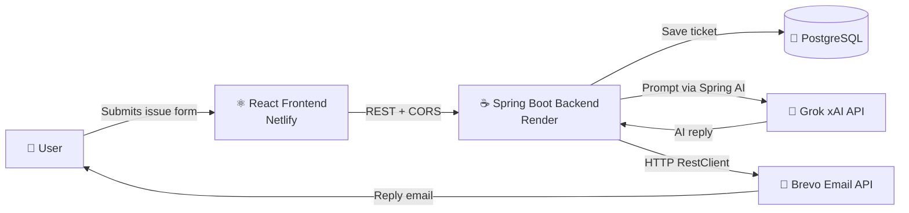
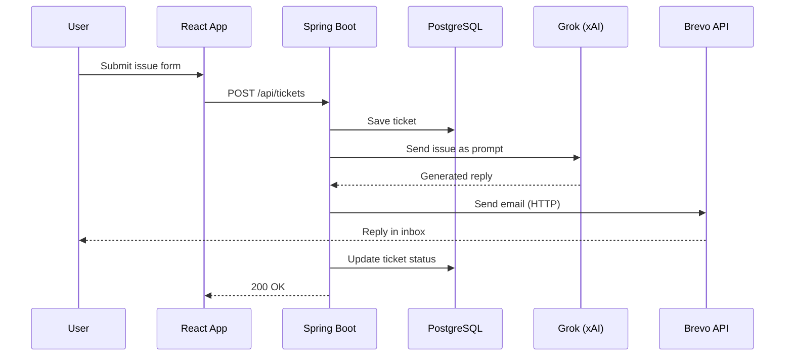

# 🤖 AI Customer Support Agent

A full-stack app that solves real customer problems automatically. A user submits an issue through a simple form, and within minutes an **AI-generated, context-aware reply lands in their inbox**, no human agent needed.
 Here is Link -> https://csm-1.netlify.app/
---

## ✨ How It Works

1. User opens the web app and fills the **issue form** (name, email, issue description).
2. The React frontend sends the request to the Spring Boot backend.
3. The backend saves the ticket  and response from grok api  via spring ai in PostgreSQL.
4. Grok generates a helpful, context-aware reply.
5. The reply is emailed to the user through the **Brevo REST API**.
6. The ticket status is updated in the database.

---

## 🏗️ Architecture



### Request Flow



---

## 🛠️ Tech Stack

| Layer | Technology |
|-------|-----------|
| Frontend | React |
| Backend | Java, Spring Boot, Spring AI |
| AI | Grok (xAI) API |
| Email | Brevo REST API (via Spring `RestClient`) |
| Database | PostgreSQL |
| Containerization | Docker, Docker Compose |
| Deployment | Netlify (frontend), Render (backend + managed DB) |

---

## 🚀 Key Highlights

- **AI-powered replies:** Spring AI + Grok generate context-aware responses based on the user's submitted issue.
- **Reliable cloud email delivery:** Render blocks outbound SMTP ports, so email was migrated from SMTP to the **Brevo HTTP REST API** using Spring's `RestClient`, giving secure, dependable transactional email in production.
- **Production deployment:** Frontend on Netlify, backend on Render with a managed PostgreSQL database.
- **Secure secret management:** All keys live in environment variables (set up after resolving a GitHub secret scanning revocation).
- **Global CORS config** for secure cross-origin communication between frontend and backend.
- **Dockerized backend + database** for one-command local setup.

---

## 📁 Project Structure

```
customer-support-agent/
├── backend/                 # Spring Boot app
│   ├── src/
│   ├── Dockerfile
│   └── pom.xml
├── frontend/                # React app
│   ├── src/
│   └── package.json
├── docker-compose.yml       # Backend + PostgreSQL
├── .env.example
└── README.md
```

---

## ⚙️ Environment Variables

Create a `.env` file in the project root (never commit it):

```env
# Database
POSTGRES_DB=support_db
POSTGRES_USER=postgres
POSTGRES_PASSWORD=your_password
SPRING_DATASOURCE_URL=jdbc:postgresql://db:5432/support_db

# AI
XAI_API_KEY=your_grok_xai_api_key

# Email (Brevo)
BREVO_API_KEY=your_brevo_api_key
BREVO_SENDER_EMAIL=you@example.com
BREVO_SENDER_NAME=Support Team

# CORS
ALLOWED_ORIGINS=http://localhost:3000
```

> 

---

## 🐳 Run Locally with Docker

Backend and database run together with Docker Compose:

```bash
# 1. Clone the repo
git clone https://github.com/tharun694/CustomerSupportManager
cd customer-support-agent

# 2. Add your .env file (see above)

# 3. Start backend + PostgreSQL
docker compose up --build
```

Backend runs at `http://localhost:8080`.

Run the frontend separately:

```bash
cd frontend
npm install
npm start
```

Frontend runs at `http://localhost:3000`.

---

## 🌐 Deployment

| Service | Platform |
|---------|----------|
| Frontend | Netlify |
| Backend | Render |
| Database | Render managed PostgreSQL |

Set all environment variables from the section above in the Render and Netlify dashboards.

---

## 🧩 Challenges Solved

| Problem | Solution |
|---------|----------|
| Render blocks SMTP ports, so emails failed in production | Switched to Brevo's HTTP REST API using Spring `RestClient` |
| API key exposed and revoked by GitHub secret scanning | Moved all secrets to environment variables |
| Frontend/backend blocked by browser cross-origin rules | Configured global CORS policy in Spring Boot |

---

## 🔮 Future Improvements

- Admin dashboard to view and manage tickets
- Ticket status tracking page for users
- Escalation to a human agent for complex issues
- Rate limiting and spam protection on the form

---

## 👨‍💻 Author

**Tharun**
Sostware Engineer (Java) | Spring Boot | Microservices

---

## 📄 License

MIT
